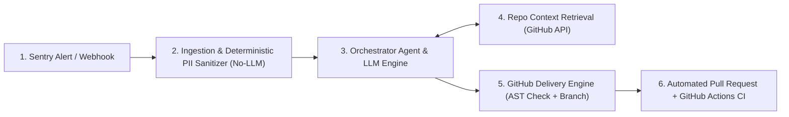

# PoC Auto-Remediation Agent (Sentry -> GitHub)

A Proof of Concept (PoC) monorepo for automated triage, deterministic PII sanitization (No-LLM), and autonomous remediation of production exceptions captured by **Sentry**, with direct integration to **GitHub** for opening automated Pull Requests containing Root Cause Analysis (RCA), code patches, and unit tests.

---

## 1. Architecture Flow



---

## 2. Monorepo Structure

```text
poc-auto-remediation/
├── .github/
│   └── workflows/
│       └── ci.yml                  # GitHub Actions CI (Ruff Lint + Pytest on Push & PRs)
├── docs/
│   ├── ARCHITECTURE_AND_WBS.md     # Full Architecture Specification & 5-Package WBS
│   └── SETUP_AND_RUNBOOK.md        # Step-by-step Setup, Configuration & Execution Guide
├── fixtures/                       # Real Sentry JSON event payloads with PII (Package 1.3)
│   ├── sentry_discount_none_bug.json
│   ├── sentry_zero_division_installments.json
│   ├── sentry_type_mismatch_billing.json
│   ├── sentry_breadcrumb_flood_settlement.json
│   └── captured/                   # Timestamped event captures (git-ignored)
├── src/
│   ├── dummy_app/                  # Package 1.2 & 1.3: Target FastAPI app with intentional bugs & PII
│   │   ├── config.py               # Environment-driven runtime configuration
│   │   ├── sentry_setup.py         # Sentry SDK initialization + before_send fixture persistence
│   │   ├── main.py                 # FastAPI endpoints & Sentry scope enrichment
│   │   ├── ui.py                   # Interactive Web Dashboard for triggering errors & inspecting JSON
│   │   └── services/
│   │       ├── checkout_service.py # Scenarios 1 (NoneType Subscript) & 2 (ZeroDivisionError)
│   │       └── auth_billing_service.py # Scenarios 3 (TypeError float+str) & 4 (Call Stack + 35 Breadcrumbs)
│   └── remediation_agent/          # Reserved for Packages 2, 3, 4, and 5
├── tests/
│   └── test_dummy_app.py           # Automated test suite & offline fixture generator
└── pyproject.toml                  # Poetry configuration, dependencies & tool settings
```

---

## 3. Quick Start

### 3.1. Install Dependencies
```bash
cd poc-auto-remediation
poetry install
```

### 3.2. Start the Dummy App Web Dashboard
```bash
# Option A: Local Offline Sandbox Mode (generates full Sentry SDK JSON fixtures in fixtures/ without cloud upload)
poetry run uvicorn dummy_app.main:app --reload --port 8000

# Option B: Connected to Sentry Cloud Sandbox (sends events to Sentry AND saves local fixtures)
SENTRY_DSN="https://<public_key>@o0.ingest.sentry.io/<project_id>" poetry run uvicorn dummy_app.main:app --reload --port 8000
```

Open **`http://localhost:8000`** in your browser:
1. Optionally paste or update your `SENTRY_DSN` directly in the top configuration bar without restarting the server.
2. Click any of the **4 Error Scenario buttons** (or click **"Trigger All Scenarios"**) to trigger the exception with realistic PII and inspect the raw Sentry Event JSON payload right in the browser.

### 3.3. Run Linter & Automated Tests
```bash
poetry run ruff check .
poetry run pytest -v
```

---

## 4. Programmed Error & PII Scenarios (Package 1.2 & 1.3)

| # | Endpoint | Exception | Target File / Function | Injected PII Vectors | PoC Validation Goal |
|---|----------|-----------|------------------------|----------------------|---------------------|
| **1** | `POST /api/scenarios/discount-bug` | `TypeError: 'NoneType' object is not subscriptable` | `src/dummy_app/services/checkout_service.py` (`apply_promotional_discount`) | CPF, Credit Card PAN, CVV, Email, Phone, Bearer JWT | Validate null-safe dictionary handling (`.get()`) and redaction of card/CPF inside `frame.vars`. |
| **2** | `POST /api/scenarios/zero-division` | `ZeroDivisionError: float division by zero` | `src/dummy_app/services/checkout_service.py` (`calculate_installment_plan`) | CPF, SSN, Full Card Number, Bearer Token, IP | Validate mathematical guard (`installments <= 0`) and SSN/CPF redaction in breadcrumbs. |
| **3** | `POST /api/scenarios/type-mismatch` | `TypeError: unsupported operand type(s) for +: 'float' and 'str'` | `src/dummy_app/services/auth_billing_service.py` (`process_recurring_charge`) | Plaintext `password`, `api_secret_key`, Bearer JWT, SSN, CPF | Validate type casting (`float()`) and strict credential scrubbing in local variables. |
| **4** | `POST /api/scenarios/breadcrumb-flood` | `AttributeError: 'NoneType' object has no attribute 'upper'` | `src/dummy_app/services/auth_billing_service.py` (`reconcile_settlement_batch` $\rightarrow$ `_audit_customer_entries` $\rightarrow$ `_extract_primary_transaction`) | 35 noisy polling breadcrumbs + CPF, SSN, Card & Token | Validate breadcrumb truncation (Package 2) and multi-frame Context Retrieval (Package 4.2). |

---

## 5. Detailed Documentation

- **[Architecture & Work Breakdown Structure (WBS)](docs/ARCHITECTURE_AND_WBS.md)**: Full specification of all components and the 5 work packages adapted for **Sentry -> GitHub**.
- **[Step-by-Step Setup & Operational Runbook](docs/SETUP_AND_RUNBOOK.md)**: Complete instructions on how to configure GitHub, Sentry Sandbox, Local Webhook Tunnels, and execute every stage of the PoC.
